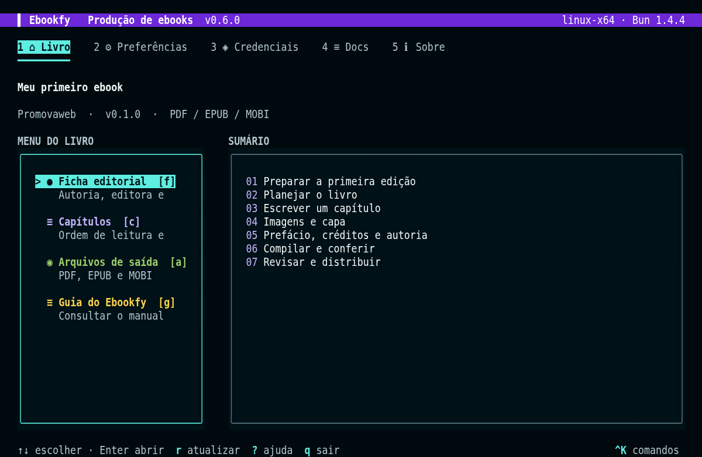

# Preparar a primeira edição {#preparar-a-primeira-edicao}

Este livro é, ao mesmo tempo, um guia e um exemplo. Cada capítulo explica uma etapa da produção de um ebook com o Ebookfy e usa, no próprio texto, o recurso que descreve. Quando terminar a leitura, você terá visto tudo o que o compilador coloca numa edição: capa, sumário, prefácio, figuras, tabelas, código, notas de rodapé, links entre capítulos, créditos e a apresentação de autoria.

O projeto que gerou este PDF é o mesmo que o comando `ebookfy init` instala. Abra os arquivos ao lado da leitura, troque um parágrafo e compile. A mudança aparece no PDF, no EPUB e no MOBI.

## Conferir a ficha

A ficha editorial é o arquivo `ebook.toml`, na raiz do livro. A tabela `[book]` guarda o título, a descrição, a autoria, o idioma e a versão da edição:

```toml
[book]
title = "Meu primeiro ebook"
description = "Um guia curto para montar, compilar e distribuir um ebook."
language = "pt-BR"
authors = ["Promovaweb"]
version = "0.1.0"
slug = "primeiro-ebook"
```

Troque `title` e `authors` pelos dados do seu livro e rode, na mesma pasta:

```bash
ebookfy info
```

O terminal mostra o título novo e a lista de capítulos na ordem das tabelas `[[chapters]]`. O comando funciona também de dentro de uma subpasta, porque o Ebookfy procura o `ebook.toml` mais próximo subindo pelas pastas.

Sem argumentos, `ebookfy` abre a interface do terminal com a mesma ficha. A aba **Livro** mostra o sumário ao lado de um menu para a ficha, os capítulos, os arquivos gerados e o guia:

{width=90%}

{width=18%}

A figura acima mora em `imagens/`, ao lado deste `CHAPTER.md`. O texto entre colchetes vira a legenda e também é lido por leitores de tela. O atributo `{width=18%}` controla a largura no PDF.

## Onde cada coisa fica

| Para alterar | Abra |
| --- | --- |
| Título, autoria, versão, formatos e ordem dos capítulos | `ebook.toml` |
| O texto de um capítulo e suas figuras | `capitulos/<pasta>/CHAPTER.md` e `imagens/` |
| Prefácio, créditos, autoria e capa | Os arquivos de `[files]`, em `editorial/` |
| Briefing, fontes, revisão e outros registros de trabalho | `notas/`, fora da edição |
| Os arquivos gerados | `ebook/`, criada pelo build |

A tabela `[files]` aponta para os textos editoriais e para as imagens da capa. A tabela `[output]` define a pasta dos arquivos gerados e os formatos da edição. Um livro só para leitores digitais, por exemplo, declara `formats = ["epub"]`.

## O caminho deste livro

Os capítulos seguem a ordem de produção de um livro:

1. [Planejar o livro](#planejar-o-livro): leitor, resultado e sumário antes da primeira linha.
2. [Escrever um capítulo](#escrever-um-capitulo): o Markdown que o compilador aceita.
3. [Imagens e capa](#imagens-e-capa): figuras com legenda e as duas capas da edição.
4. [Prefácio, créditos e autoria](#abertura-e-fechamento): os textos que abrem e fecham o livro.
5. [Compilar e conferir](#compilar-e-conferir): os conversores, o build e a prova dos arquivos.
6. [Revisar e distribuir](#revisar-e-distribuir): a última leitura, a versão e a entrega.

Cada etapa tem uma skill numerada em `.agents/skills/`, de `ebookfy-01-organizar` a `ebookfy-14-distribuir`. A skill `ebookfy-15-migrar` traz para o Ebookfy um livro escrito em outra ferramenta.
