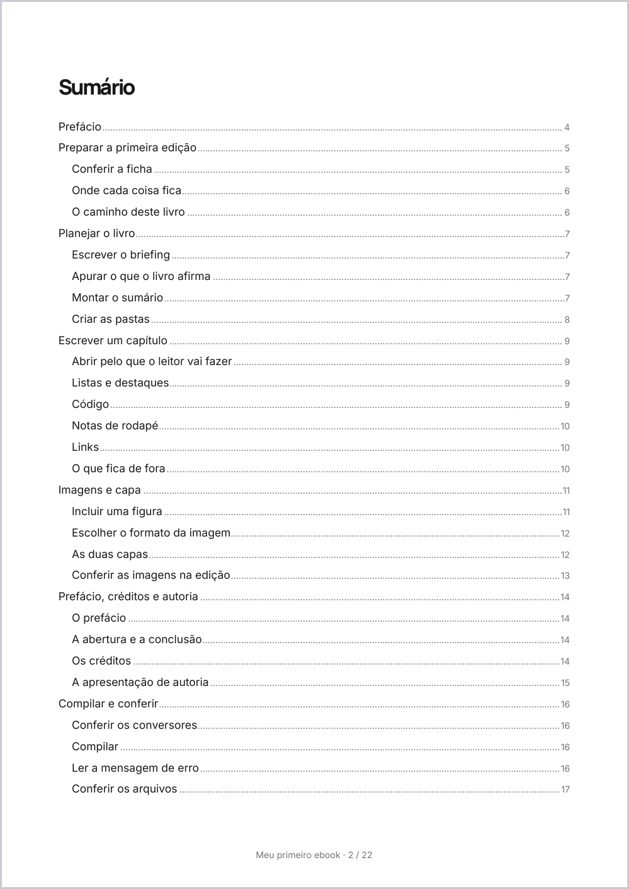

# Compilar e conferir {#compilar-e-conferir}

Com a ficha e os capítulos prontos, gere os formatos declarados em `output.formats`. Neste capítulo, você confere os conversores, compila a edição e prova cada arquivo antes de entregar.

## Conferir os conversores

O Ebookfy usa programas externos para cada formato. O comando `doctor` mostra a versão de cada um e avisa quais formatos ficam indisponíveis quando falta algum:

```bash
ebookfy doctor
```

| Formato | Programa |
| --- | --- |
| EPUB | Pandoc |
| PDF | Pandoc e WeasyPrint |
| MOBI | Pandoc e `ebook-convert`, do Calibre |

## Compilar

Na raiz do livro, ou em qualquer subpasta dele, rode:

```bash
ebookfy build
```

O `build` grava os arquivos na pasta `ebook/`, com o slug e a versão no nome, como `ebook/primeiro-ebook-v0.1.0.pdf`. Os arquivos só substituem a edição anterior quando todos os formatos compilam. Se um falhar, a pasta fica como estava.

O compilador trata qualquer aviso do Pandoc como erro. Assim, uma imagem que falta ou uma nota duplicada interrompem o build em vez de passar despercebidas.

## Ler a mensagem de erro

A primeira linha da mensagem diz qual programa falhou e por quê:

| Mensagem | Causa | Correção |
| --- | --- | --- |
| `Could not fetch resource` | Imagem fora do caminho indicado. | Corrija o caminho relativo ao `CHAPTER.md`. |
| `Duplicate note reference` | Dois capítulos com o mesmo rótulo de nota. | Prefixe os rótulos com o capítulo. |
| `Duplicate identifier` | Dois títulos com o mesmo `{#id}`. | Troque um dos identificadores. |
| `Unrecognized key` | Chave desconhecida no `ebook.toml`. | Confira o nome da chave na ficha. |

## Conferir os arquivos

Abra os arquivos recém-gerados e percorra a lista:

- [ ] a capa digital no EPUB e a página de capa no PDF;
- [ ] o sumário, com todos os capítulos na ordem;
- [ ] as figuras com legenda e as tabelas inteiras;
- [ ] os blocos de código com realce;
- [ ] as notas de rodapé e os links entre capítulos;
- [ ] o prefácio no início, os créditos e a autoria no fim.

{width=55%}

O sumário do PDF é montado a partir dos títulos `#`, `##` e `###` de cada capítulo. Um título fora do lugar no sumário aponta direto para o nível de cabeçalho errado no Markdown.

Abra o EPUB em pelo menos um leitor digital, como o Calibre ou o Apple Books. O MOBI serve a Kindles antigos; o envio pelo Send to Kindle aceita o EPUB.
